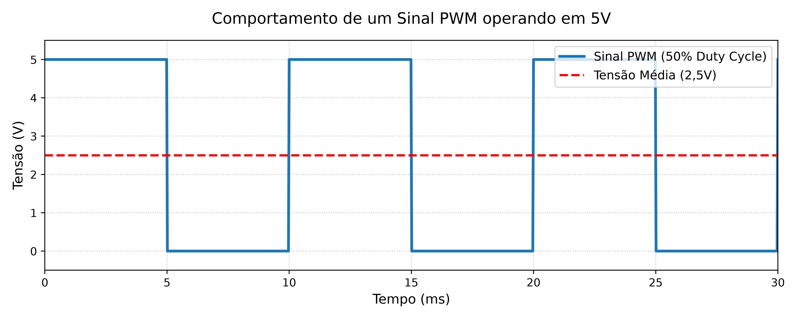
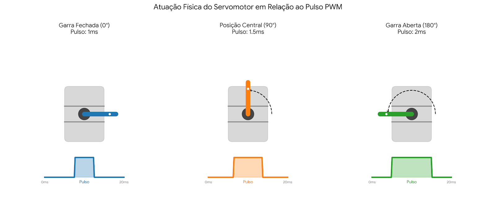

# Controle PWM na Entrega de Pacote

*Como controlamos a garra via software na Task 3 da Black Bee Challenge 2026*

**Missão Realizada por Ana Machado e João Fornazeiro - Equipe Black Bee Drones**

**Documento feito por Ana Machado e João Fornazeiro**

---

Na robótica, o **PWM (Pulse Width Modulation)** é um conceito fundamental e muito abrangente. O controle dos motores que mantêm nosso drone no ar, por exemplo, depende dessa técnica. Neste artigo, porém, focaremos em uma aplicação mais pontual desse conceito: o acionamento de servo motores.

Primeiro, vamos explicar o funcionamento do controle PWM e, em seguida, demonstrar como aplicamos esse conceito na **Task 3 (Package Delivery)** da Black Bee Challenge 2026. Por fim, finalizaremos com os resultados que obtivemos e o que aprendemos ao desenvolver essa missão.

## O que é o PWM?
**PWM**, ou Pulse Width Modulation (Modulação por Largura de Pulso), é uma técnica engenhosa para obter valores analógicos (contínuos, com valores intermediários) a partir de sinais digitais (descontínuos, binários).

Sistemas digitais operam em apenas dois estados extremos: ligado (HIGH) ou desligado (LOW). No entanto, muitas aplicações no mundo real precisam de estados intermediários. Se quisermos controlar o brilho de um LED ou a velocidade de rotação das hélices do nosso drone, não podemos simplesmente usar "tudo ou nada" é preciso, portanto, fazer o uso do PWM, o qual cria a "ilusão" de um valor intermediário alternando muito rápido entre o estado ligado e o desligado.

Assim, o formato desse sinal é definido por duas grandezas principais:
  1. **Frequência**: A quantidade de vezes que o ciclo de liga/desliga se repete em um segundo, medido em Hertz (Hz).
  2. **Duty Cycle (Ciclo de Trabalho)**: A porcentagem de tempo em que o sinal permanece "ligado" (HIGH) dentro de um único ciclo, em relação ao tempo total.

Por exemplo: se um sinal PWM tem um duty cycle de 50%, ele passa metade do tempo em HIGH e metade em LOW. Desse modo, supondo que o sistema opere em 5V, o componente conectado àquele pino "enxergará" uma tensão média de 2,5V.

<div align="center">
    
</div>

### Servos e o PWM
Quando aplicamos PWM em um LED ou em motores DC convencionais, a variação do duty cycle imita uma variação de energia contínua. No entanto, com servo motores (como o responsável por abrir e fechar a garra que carrega o nosso pacote), a lógica muda.

Nos servos, a placa de controle lê o tempo que o pulso fica em nível HIGH (a largura do pulso) e traduz essa duração em um ângulo específico.

A maioria dos servo motores trabalha em uma frequência fixa de 50 Hz. Isso significa que um pulso é enviado a cada 20 milissegundos (ms). O que determina o ângulo é quanto desses 20 ms o sinal fica ligado:
- Um pulso de 1 ms (duty cycle de ~5%) comanda o servo para a posição 0°;
- Um pulso de 1,5 ms (duty cycle de ~7,5%) comanda o servo para a posição central 90°;
- Um pulso de 2 ms (duty cycle de ~10%) comanda o servo para o limite 180°.

<div align="center">
    
</div>

## O PWM em Ação
Na **Task 3 (Package Delivery)** do Black Bee Challenge 2026, o objetivo principal do drone era voar até a área designada, alinhar-se com a caixa e soltar o pacote de forma precisa. 

Para fazer essa missão de forma autônoma, utilizamos um servo motor conectado ao mecanismo da garra, controlado diretamente via software por meio do [**Nectar**](https://github.com/Black-Bee-Drones/nectar-sdk), o SDK criado pela equipe Black Bee Drones, o qual abstrai em métodos e funções simples toda a programação complexa que fazíamos antes de forma não modularizada e adaptada a cada nova competição, que pode ser utilizada tanto no drone real quanto na simulação via Gazebo.

### O teste de bancada
Antes de integrar qualquer lógica de acionamento ao voo autônomo, precisamos garantir que o hardware responda corretamente e, mais importante, calibrar seus limites. Servo motores possuem batentes mecânicos: se o software enviar um pulso PWM que force o motor a girar além do que a estrutura da garra permite, as engrenagens internas podem espanar ou o motor pode queimar por sobrecarga.

Para fazer essa calibração com segurança, utilizamos o script interativo, presente no SDK, [`servo_test.py`](https://github.com/Black-Bee-Drones/nectar-sdk/blob/main/nectar/nectar/examples/control/servo_test.py)   

#### Como o script funciona?
O script opera como um terminal iterativo (um *REPL*). Ao ser iniciado, ele estabelece uma conexão com a controladora de voo via protocolo MAVLink (seja por rede ou por um barramento serial, como o `/dev/ttyAMA1`). A partir daí, cada vez que digitamos um comando no terminal, o script traduz essa entrada, enviando o valor exato de PWM direto para o canal AUX especificado. 

##### O processo de calibração
Iniciamos o script informando a porta de comunicação e o canal do servo (neste caso, o canal 2):

```bash
python3 servo_test.py --drone mavlink --connection /dev/ttyAMA1 --channel 2
```  

Depois, testamos os valores por meio de comandos diretos de PWM, como no exemplo:

```bash
servo> ch 2              # Alterna para o canal de AUX OUT desejado
servo> 1500              # Envia um pulso de 1500µs
```

Na prática, não usamos os extremos teóricos (1000µs e 2000µs), porque cada mecanismo tem seus próprios batentes físicos. Então, por meio desse mapeamento na bancada que alcançamos os valores exatos de PWM (1400 e 1900) que mais tarde iriam para o código principal do voo.

### Configurando a garra
Com os valores mapeados nos testes, definimos qual canal o servo está conectado e os limiares de PWM para o manuseio do pacote no arquivo `constants.py` da missão.

Trecho extraído do arquivo com as constantes:
```python
# Gripper Controller
servo_channel : int = 2         # Número da porta AUX OUT
servo_open_pwm : int = 1400     # Pulso em microssegundos para abrir a garra
servo_closed_pwm : int = 1900   # Pulso em microssegundos para fechar a garra
```

### O estador Gripper
Assim como em outras partes da nossa arquitetura, o controle geral da missão é estruturado como uma máquina de estados utilizando a biblioteca `YASMIN`. Nesse sentido, a ação de soltar o pacote acontece em um estado específico chamado `Gripper`, que é chamado logo após a centralização do drone com a caixa.

#### Comunicação com o servo e a lógica de *Retries*
Na robótica do mundo real, a comunicação serial entre a Raspberry Pi e a controladora de voo pode sofrer ruídos ou perder pacotes esporádicos. Um comando MAVLink mandando o servo abrir a garra pode simplesmente não ser executado.

Se isso acontecer, abortar a missão inteira seria um desperdício. Por isso, desenvolvemos a função auxiliar `do_gripper`, construída com uma lógica de tolerância a falhas (ou *retries*):

```python
def do_gripper(drone, config: Config, closed: bool) -> bool:
    # Definindo o valor de PWM com base no atual estado do servo
    pwm = config.servo_closed_pwm if closed else config.servo_open_pwm
    retries = max(1, int(config.servo_retries))

    # Loop for com a lógica de tentativas
    for attempt in range(1, retries + 1):
        yasmin.YASMIN_LOG_INFO(f"Set {pwm} pwm (attempt {attempt}/{retries})")
        
        # Tenta enviar o comando de servo à controladora de voo
        if drone.do_servo(aux_out=config.servo_channel, pwm_value=pwm):
            drone.delay(config.servo_action_delay)
            return True
            
        yasmin.YASMIN_LOG_WARN(f"do_servo failed (attempt {attempt}/{retries})")
        
        # Se falhou, espera um tempo antes de tentar de novo
        if attempt < retries:
            drone.delay(config.servo_retry_delay)
            
    yasmin.YASMIN_LOG_ERROR("Failed to do servo.")
    return False
```

Nesta função, verificamos primeiro se queremos a garra fechada ou aberta, selecionando o PWM calibrado nas constantes (1900 ou 1400) e definimos o número máximo de tentativas.

```python
pwm = config.servo_closed_pwm if closed else config.servo_open_pwm
retries = max(1, int(config.servo_retries))
```

Em seguida, em vez de mandar o pulso uma única vez, usamos um laço for da seguinte forma:

```python
for attempt in range(1, retries + 1):
    yasmin.YASMIN_LOG_INFO(f"Set {pwm} pwm (attempt {attempt}/{retries})")
    
    if drone.do_servo(aux_out=config.servo_channel, pwm_value=pwm):
        drone.delay(config.servo_action_delay)
        return True
        
    yasmin.YASMIN_LOG_WARN(f"do_servo failed (attempt {attempt}/{retries})")
    
    if attempt < retries:
        drone.delay(config.servo_retry_delay)
```

Assim, o comando `drone.do_servo` tenta enviar o sinal para a controladora. Se retornar sucesso, aplicamos um delay de três segundos (`servo_action_delay`) para dar tempo mecânico de a garra abrir completamente e o pacote cair antes de o drone voltar a se mover. Caso o envio falhe, enviamos um log de aviso (*warning*) e aguardamos meio segundo (`servo_retry_delay`) antes da próxima tentativa. 

Por fim, se esgotarmos todas as tentativas e sairmos do loop, a função retorna `False`. 

```python
yasmin.YASMIN_LOG_ERROR("Failed to do servo.")
return False
```

#### Aplicação no código da missão
Com a comunicação com o servo protegida, inserimos essa função no estado `Gripper`. 

É importante mencionar que a biblioteca `YASMIN` utiliza um conceito chamado `Blackboard`, que funciona como uma quadro de memória compartilhada entre todos os estados do drone. É lá que guardamos a instância de controle do drone e a flag que indica se ele está carregando a caixa. 

Primeiro, realizamos algumas verificações para checar se as variáveis que iremos utilizar estão presentes na blackboard.

```python
drone = blackboard.get("drone")
if drone is None:
    yasmin.YASMIN_LOG_ERROR("Drone missing.")
    return ABORT

if "has_thePkg" not in blackboard:
    yasmin.YASMIN_LOG_ERROR("Flag - has the pkg - not found.")
    return ABORT
```

Depois, ajustamos a altura do drone e zeramos o seu momento inercial, garantindo um lançamento preciso do pacote.

```python
drone.move_to(z=-0.8)
drone.move_velocity(0.0, 0.0, 0.0)
```

Por fim, o servo é acionado com a função ```do_gripper```. Caso o servo falhe mais do que o número máximo de tentativas definido, abortamos a missão.

```python
if not do_gripper(drone, self.config, self.target_has_pkg):
  return ABORT
```

Em caso de sucesso, atualizamos na blackboard a variável `has_thePkg`, flag que sinaliza que o pacote já foi entregue, e passamos para o próximo estado. 

```python
blackboard["has_thePkg"] = self.target_has_pkg
yasmin.YASMIN_LOG_INFO("Completed successfully.")
return SUCCEED
```

## Problemas Enfrentados
Apesar de a lógica e do controle PWM da garra estarem consolidados, a execução no dia da competição nos apresentou desafios práticos de hardware e visão computacional:

1. **Iluminação excessiva devido ao ambiente ensolarado**:
   
    No dia da prova, o sol forte fez com que as caixas fossem capturadas pela câmera como grandes "borrões" brancos devido à superexposição. Como nosso modelo de detecção de objetos havia sido treinado sem técnicas de *data augmentation* e utilizando fotos tiradas sob condições de céu nublado, o sistema inicialmente não conseguiu reconhecer os alvos. 
   
    Para contornar essa situação no local, realizamos um *fine-tuning* emergencial do modelo e ajustamos o nível de claridade da câmera via linha de comando utilizando o utilitário **v4l2-ctl**, proveniente do Video4Linux2 (V4L2) — uma coleção de drivers e APIs do ecossistema Linux voltada para o controle direto de dispositivos de captura de vídeo em tempo real.

    Primeiramente, identificamos qual era o caminho da câmera conectada através do comando bash: 
    ```bash
    v4l2-ctl --list-devices
    ```
    
    Esse comando exibe todos os dispositivos de vídeo detectados e mapeados no diretório `/dev/` (como `/dev/video0`, `/dev/video1`, etc.).

    Posteriormente, especificamos, através do parâmetro -d o arquivo de dispositivo referente ao sensor da câmera conectado ao sistema (como `/dev/video0` para a câmera principal ou USB principal do Linux). Através da flag --set-ctrl, é possível sobrescrever configurações do sensor, tais como exposição, ganho, contraste e brilho. A maioria dos drivers de câmera define o controle de brilho (brightness) em uma escala numérica de 0 a 255 (onde 0 representa o nível mínimo de brilho e 255 a saturação máxima, tendo o valor 128 como padrão comum).

    Após realizarmos testes empíricos de iluminação na arena para equilibrar o contraste das imagens e evitar o estouro de brancos nas caixas, reduzimos o brilho da câmera para a metade do limite padrão (brightness=50), executando o comando via terminal:
   
    ```bash
    v4l2-ctl -d /dev/video0 --set-ctrl brightness=50
    ```

2. **Imprecisão do GPS**:

    Tivemos oscilações e desvios nas leituras do GPS que dificultaram a aproximação e o alinhamento autônomo do drone com a caixa alvo. Em cenários reais de competição com múltiplos alvos próximos, a variação de precisão do GPS torna um desafio crítico fazer o drone focar exclusivamente na caixa objetivo correta sem divergir em direção a outros objetos na arena.

    Infelizmente, durante a janela de voo da competição, não foi possível implementar uma solução definitiva para compensar essa variação do GPS no alinhamento fina

## Conclusão
Embora as intercorrências com as condições de iluminação e a precisão do GPS tenham imposto desafios significativos ao voo autônomo e à navegação até a caixa, o módulo de controle da garra `gripper.py` e a integração do sinal PWM via MAVLink funcionaram perfeitamente durante todos os acionamentos e testes.

A implementação da técnica de PWM aliada à lógica de tolerância a falhas (retries) provou ser extremamente robusta e confiável, garantindo que os pulsos de comando para abertura e fechamento do servo fossem entregues sem perdas.

Desenvolver e validar essa solução — desde a calibração de bancada com o `servo_test.py` até a estruturação da máquina de estados no `YASMIN` — nos proporcionou um aprendizado valioso sobre a importância da modularização de software com o **Nectar SDK**, além do manuseio prático de atuadores físicos e da gestão de imprevistos no campo da robótica autônoma, sobretudo de drones.
