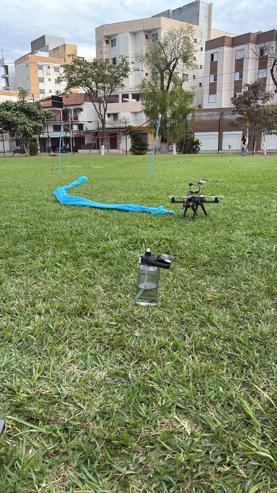
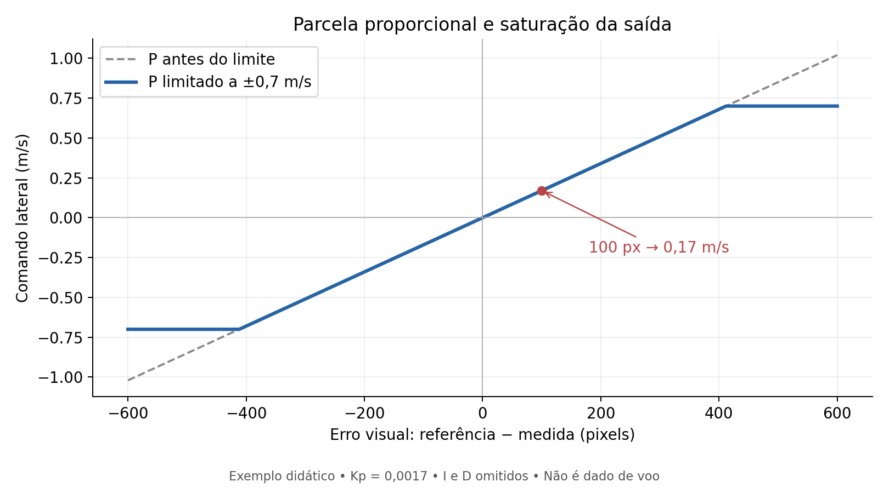
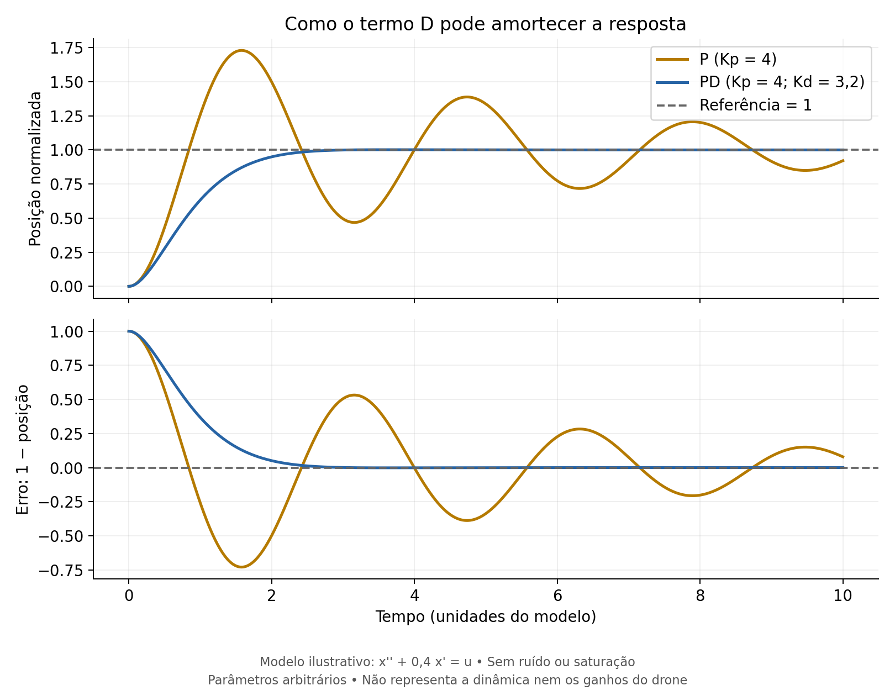
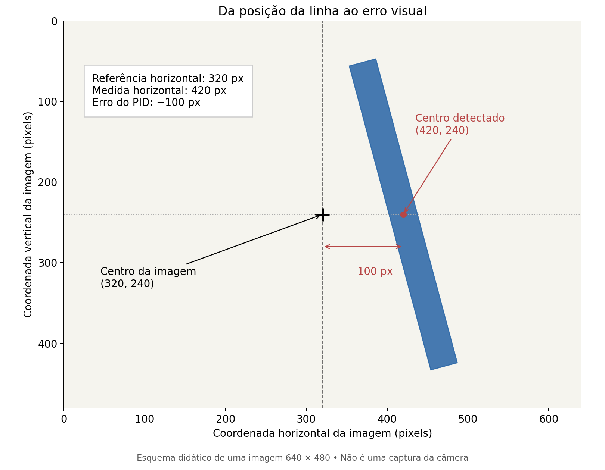
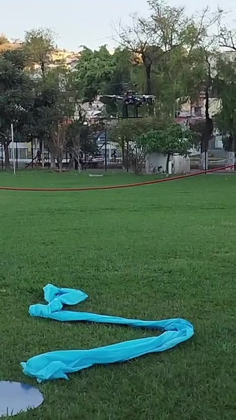
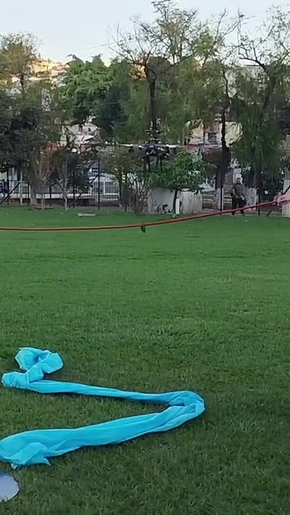

# Do Chão À Mangueira: Visão Computacional, Máquinas de Estados e Controle PID

*Como usamos a câmera e o controle em malha fechada para seguir uma linha e soltar um gancho na Task 4 da Black Bee Challenge 2026*

**Missão realizada por Arthur Xavier Ribeiro, Marco Antônio Ranghetti e Pedro Brandão — Black Bee Drones**

**Texto por Arthur Xavier Ribeiro, Marco Antônio Ranghetti e Pedro Brandão**

---

A câmera encontra uma linha azul no chão. O drone precisa segui-la, mas a linha aparece deslocada e inclinada na imagem. Como transformar essa informação em um movimento que corrija a trajetória? E como adaptar esse controle quando, ao fim do caminho, o alvo passa a ser uma mangueira suspensa?

Esse foi o problema que enfrentamos na **Task 4 — Hang the Hook**, ou Missão de Soltura de Gancho, da Black Bee Challenge 2026. O objetivo era seguir autonomamente a rota e, ao chegar à mangueira, alinhar o drone para soltar um gancho sobre ela. Como o comprimento do percurso não era informado previamente, a navegação precisava acompanhar o que a câmera enxergava durante o voo.

Neste artigo, explicamos primeiro o controle PID e a visão computacional que usamos. Depois, mostramos como combinamos essas ferramentas na missão, incluindo os ganhos, os cálculos e os trechos de código. Por fim, contamos os resultados dos testes, o que aconteceu na competição e o que aprendemos.

<div align="center">
    
</div>

*Montagem de teste da missão: a linha azul no chão, a mangueira suspensa e o drone antes do voo.*

## O que é o controle PID?

PID vem de **Proporcional, Integral e Derivativo**. É um controlador de malha fechada: ele compara o valor desejado, chamado *setpoint*, com uma medida do sistema e usa essa diferença para calcular uma correção. Depois do movimento, uma nova medida permite repetir o processo.

Na nossa missão, a medida vem da câmera. Imagine uma imagem com 640 pixels de largura: seu centro horizontal está em 320. Se o centro da linha aparece na posição 220, o erro usado pelo controlador é:

```text
erro = referência − medida
erro = 320 − 220 = 100 pixels
```

Queremos transformar esses 100 pixels em uma velocidade lateral que aproxime a linha do centro da imagem. Conforme o drone se move, a posição observada muda, o erro é recalculado e o comando também muda. O controlador tem três parcelas para construir essa resposta.

### O Proporcional (P)

O proporcional gera uma correção diretamente ligada ao erro atual:

$$
P(t) = K_p e(t)
$$

Usando o ganho lateral do seguimento de linha, **Kp = 0,0017**, um erro de 100 pixels gera uma parcela proporcional de **0,17 m/s**. Se o erro cair para 20 pixels, essa parcela cai para **0,034 m/s**. A correção fica menor conforme o alvo se aproxima da referência.

Esses números representam apenas a parcela P. O comando final ainda depende das outras parcelas e dos limites de saída. O sinal do comando também depende da convenção dos eixos da câmera e do drone, que precisa ser conferida na integração.

<div align="center">
    
</div>

*Exemplo didático calculado com Kp = 0,0017. A faixa de erro foi ampliada para mostrar a saturação; não representa uma medição de voo nem a faixa de posições possíveis em uma imagem de 640 pixels.*

### O Integral (I)

O integral acumula o erro ao longo do tempo:

$$
I(t) = K_i \int_0^t e(\tau)\,d\tau
$$

Se uma perturbação mantiver o drone um pouco afastado da referência, essa diferença persistente pode gerar uma correção integral crescente. Em um sistema bem ajustado, isso ajuda a reduzir o erro que permanece depois da resposta inicial.

Esse acúmulo também precisa de limite. Se o comando já estiver saturado e o integral continuar crescendo, o controlador pode demorar a reduzir a correção quando o alvo for alcançado. É o chamado *integral windup*.

Na configuração do Hang the Hook, **Ki = 0** tanto no seguimento da linha quanto no alinhamento com a mangueira. Portanto, o integral não contribui para os comandos dessas etapas. A classe utilizada é um `PIDController`, mas o controle configurado opera como **PD**.

### O Derivativo (D)

O derivativo considera a velocidade com que o erro muda:

$$
D(t) = K_d \frac{de(t)}{dt}
$$

Se um erro positivo estiver diminuindo rapidamente, sua derivada será negativa. Essa parcela pode reduzir o comando antes que o drone ultrapasse a referência, ajudando a amortecer a resposta. O efeito depende da dinâmica do sistema e dos ganhos escolhidos.

O D também reage às variações provocadas por ruído. Se o centro detectado saltar entre quadros, o controlador pode interpretar esse salto como uma mudança rápida do erro. Por isso, a qualidade da imagem, a estabilidade da detecção e o intervalo entre atualizações influenciam o controle.

<div align="center">
    
</div>

*Simulação didática de um modelo de segunda ordem, com parâmetros arbitrários. A curva ilustra o amortecimento que o D pode produzir; não representa a dinâmica, os ganhos ou os resultados do nosso drone.*

### A saída completa e seus limites

A soma das três parcelas forma a saída do PID:

$$
u(t) = K_p e(t) + K_i \int_0^t e(\tau)\,d\tau + K_d \frac{de(t)}{dt}
$$

No Nectar, essa soma passa pelos **limites de saída**, que restringem o comando final. O controlador também oferece **limites para a parcela integral**, usados para conter seu acúmulo. Como desabilitamos I nesta missão, os limites de saída são os que restringem diretamente as correções de P e D.

Os controladores de translação são inicializados com limites de **−0,7 a 0,7 m/s**. O controlador de *yaw*, a rotação em torno do eixo vertical, usa limites de **−0,65 a 0,65 rad/s**. Esses valores limitam os comandos enviados ao drone; não são uma garantia sobre a velocidade efetivamente atingida durante o voo.

## O que a visão computacional entrega ao controle?

Uma imagem contém milhares de pixels, mas o controlador precisa de poucas medidas: **onde o alvo está e qual é sua orientação**. A visão computacional faz essa transformação.

No Hang the Hook, usamos a cor para separar o alvo do restante da imagem e sua geometria para estimar centro e inclinação. O processo passa por três etapas: converter a representação das cores, criar uma máscara e extrair as medidas da região encontrada.

### Separando o alvo pela cor

O OpenCV normalmente fornece imagens com canais BGR: azul, verde e vermelho. Para filtrar as cores da missão, usamos dois outros espaços:

- **HSV**, que representa matiz, saturação e valor, na detecção da linha azul.
- **LAB**, que representa luminosidade e dois eixos cromáticos, na detecção da mangueira vermelha.

A configuração define intervalos de cor aceitos pelo detector. Os pixels dentro desses intervalos formam uma **máscara binária**: branco para as regiões selecionadas e preto para o restante. Assim, o processamento geométrico pode procurar a linha nessa máscara.

Essa separação exige calibração. Sol, sombra, exposição da câmera e materiais diferentes podem alterar os valores dos pixels. Usar HSV ou LAB facilita definir os intervalos, mas a detecção continua dependendo das condições em que a imagem foi capturada.

### Da máscara ao centro e ao ângulo

Os dois detectores da missão usam o método `RotatedRect`. Ele procura o maior contorno da máscara e, quando o contorno atende ao critério de área, ajusta um retângulo rotacionado à região. A partir dessa geometria, são estimados o centro e a orientação do alvo.

O `LineDetector` devolve a imagem, a máscara e medidas como `center_x`, `center_y` e `angle`. São esses números que ligam a visão ao controlador. Para seguir a linha azul, usamos principalmente a posição horizontal e o ângulo; para alinhar sobre a mangueira, usamos também a posição vertical na imagem.

<div align="center">
    
</div>

*Esquema didático: com referência em 320 e medida em 420, o erro interno do PID é −100 pixels. A faixa azul desenhada é apenas uma ilustração.*

Um problema no Raspberry Pi impediu que as imagens da câmera embarcada fossem salvas durante os testes. Por isso, este esquema explica a geometria do controle, mas não mostra uma detecção registrada em voo. As fotos do artigo são registros externos da montagem e do teste.

## Aplicando o PID e a visão na missão

A missão tem dois objetivos de controle distintos. Durante a navegação, queremos avançar acompanhando a linha azul. Perto da mangueira, queremos centralizar e orientar o drone antes de descer. Cada etapa usa ganhos próprios.

### Os controladores

Os valores configurados nos arquivos `followlineSM/constants.py` e `hookSM/constants.py` são:

| Etapa | Correção | Kp | Ki | Kd |
|---|---|---|---|---|
| Seguir a linha | Posição horizontal → velocidade lateral | 0,0017 | 0 | 0,0001 |
| Seguir a linha | Ângulo → velocidade de yaw | 0,013 | 0 | 0,001 |
| Alinhar com a mangueira | Posição horizontal → velocidade lateral | 0,0014 | 0 | 0,0002 |
| Alinhar com a mangueira | Posição vertical → velocidade longitudinal | 0,0014 | 0 | 0,0002 |
| Alinhar com a mangueira | Ângulo → velocidade de yaw | 0,002 | 0 | 0,0002 |

Esses ganhos pertencem à configuração do pacote. A resposta depende também da câmera, da orientação dos eixos e do comportamento da aeronave; copiar os números para outra montagem não reproduz automaticamente o mesmo movimento.

### Calculando o erro em pixels e graus

No seguimento da linha, a referência horizontal é metade da largura da imagem, e a referência angular é zero:

```text
erro de posição = largura / 2 − centro horizontal da linha
erro de ângulo = 0 − ângulo da linha
```

O PID recebe as medidas e calcula essas diferenças internamente. **Nesta missão, os erros de posição permanecem em pixels**, e o erro angular usa os graus fornecidos pelo detector. Os ganhos relacionam essas entradas às saídas de velocidade linear e angular esperadas pelo Nectar.

Isso também significa que a escala da imagem importa. A mesma distância física pode corresponder a quantidades diferentes de pixels conforme a altitude, a resolução e o campo de visão da câmera. A calibração precisa considerar a faixa de operação da missão.

### Seguindo a linha azul

O drone avança com uma velocidade configurada de **0,37 m/s** no referencial do corpo. Ao mesmo tempo, o controlador lateral busca colocar a linha no centro da imagem, enquanto o de yaw corrige sua inclinação. Centralização e orientação precisam trabalhar juntas: uma linha pode passar pelo centro da imagem e ainda apontar para uma direção diferente da frente do drone.

Antes de iniciar esse seguimento, `SearchBlueLine` pede detecções estáveis: cinco para confirmar a linha azul e dez para a mangueira vermelha nessa busca inicial. A estabilidade é avaliada pela variação do centro entre leituras. Durante o seguimento, a mangueira continua sendo procurada e pode encerrar essa etapa quando for confirmada.

### Alinhando o gancho com a mangueira

Ao encontrar a mangueira, o objetivo passa a ser **posicionar o mecanismo do gancho sobre o alvo e ajustar sua orientação para a soltura**. O avanço constante usado no seguimento da linha dá lugar ao controle dos dois deslocamentos na imagem e da rotação. Durante o estado `Align`, o comando vertical permanece em zero enquanto essas correções são calculadas.

O detector fornece `hose_x`, `hose_y` e `hose_yaw`: o centro e a inclinação da mangueira observados pela câmera. Com a resolução configurada de **640 × 480**, os erros internos dos controladores são:

```text
erro horizontal = 320 − hose_x
erro vertical   = (240 + SHIFT) − hose_y
erro angular    = 0 − hose_yaw
```

Cada erro atua em uma correção:

| Medida na imagem | Comando | Objetivo |
|---|---|---|
| Posição horizontal da mangueira | `vy`, velocidade lateral | Aproximar o alvo da referência horizontal do gancho. |
| Posição vertical da mangueira | `vx`, velocidade longitudinal | Aproximar o alvo da referência longitudinal do gancho. |
| Inclinação da mangueira | `vyaw`, velocidade de rotação | Levar a orientação observada à referência de zero grau. |

Essas três correções são aplicadas juntas. Por exemplo, se a mangueira aparecer em `(380, 180)`, com inclinação de `25°` e `SHIFT = 0`, os erros serão `−60 px`, `+60 px` e `−25°`. Com os ganhos da etapa, apenas as parcelas proporcionais produziriam `vy = −0,084 m/s`, `vx = +0,084 m/s` e `vyaw = −0,05 rad/s`. As parcelas derivativas também entram no comando final, conforme a variação desses erros ao longo do tempo. Nesse exemplo, o alvo ainda está fora das tolerâncias e o drone precisa continuar alinhando.

### Da referência da câmera à posição do gancho

Para esse controle posicionar o gancho, precisamos relacionar a imagem à montagem mecânica. O centro da câmera e a posição do mecanismo de soltura podem ter um deslocamento entre si. O parâmetro **`SHIFT`** permite ajustar a referência vertical na imagem para considerar essa diferença: em vez de procurar a mangueira exatamente em `(320, 240)`, procuramos em `(320, 240 + SHIFT)`.

Na configuração atual, **`SHIFT = 0`**, portanto o código usa o centro da imagem. Esse parâmetro é um ajuste fixo em pixels; sua correspondência com a posição física do gancho depende da montagem e da altura de operação. O sistema observa a mangueira e usa essa relação geométrica para posicionar o mecanismo, sem detectar visualmente o próprio gancho.

O yaw completa esse alinhamento: estar sobre a mangueira resolve a posição, mas a orientação também precisa corresponder à montagem do gancho. Por isso, a referência angular de zero grau deve ser interpretada junto à orientação da câmera e do mecanismo no drone.

<!-- IMAGEM A INSERIR — assets/relacao-camera-gancho.png
Foto anotada ou esquema da montagem real, mostrando câmera, mecanismo de soltura e mangueira.
Relacionar a posição do gancho à referência na imagem. Mostrar SHIFT = 0 na configuração descrita;
se ilustrar uma compensação não nula, identificá-la como exemplo e usar medidas verificadas.
<div align="center">
    
</div>
Legenda: Relação entre o alvo observado pela câmera e a posição do mecanismo de soltura.
-->

### Confirmando a posição antes de descer

O alinhamento exige erros de posição de até **45 pixels** em cada eixo e inclinação menor que **20 graus** em módulo. O código acumula cinco detecções alinhadas para autorizar a descida; uma detecção válida fora da tolerância reinicia essa contagem. Ao confirmar o alinhamento, envia velocidades nulas por **0,5 segundo** e passa a `Descend`.

Durante a descida, a mangueira continua sendo observada. Se uma detecção mostrar que o alinhamento saiu da tolerância, o drone interrompe a descida e volta a aplicar as correções em `Align`. Assim, a aproximação do gancho combina uma condição visual de posição e orientação com a condição de altitude usada para acionar o servo.

## Implementação no código

### O Nectar SDK

O **[Nectar](https://github.com/Black-Bee-Drones/nectar-sdk)** é um SDK desenvolvido pela Black Bee Drones que reúne abstrações para recursos usados em missões autônomas. Na camada de controle, encapsula mensagens MAVLink enviadas com `pymavlink`. Na visão, organiza captura e processamento de imagens com OpenCV. Também oferece o módulo `nectar.ai`, com interfaces para detecção, segmentação e classificação por modelos de inteligência artificial.

No Hang the Hook, usamos principalmente `MavlinkDrone`, `PIDController`, `ImageHandler` e `LineDetector`. A percepção desta missão utiliza cor e geometria. O módulo de IA faz parte dos recursos do SDK, mas não é utilizado nesta implementação.

Assim, o código da missão pode expressar ações como obter uma imagem, detectar uma linha ou comandar uma velocidade por meio de chamadas como `take_photo()`, `detect_line()` e `move_velocity()`.

### Preparando os detectores

No estado `Initialize`, os dois alvos recebem configurações próprias:

```python
linedetector = LineDetector(
    color="blue_line",
    estimation_method=RotatedRect(),
    color_space=ColorSpace.HSV,
)

hosedetector = LineDetector(
    color="red_hose",
    estimation_method=RotatedRect(),
    color_space=ColorSpace.LAB,
)
```

Os nomes `blue_line` e `red_hose` identificam os intervalos de cor calibrados. A escolha do alvo, do espaço de cores e do método geométrico fica explícita na criação de cada detector.

Durante o seguimento, a detecção da linha fornece as medidas utilizadas pelo controle:

```python
resultBlue, _, cxBlue, cyBlue, angleBlue, _, _ = linedetector.detect_line(
    frame, draw=False
)
```

O parâmetro `draw=False` desativa as marcações visuais sobre a imagem processada. Com `draw=True`, o detector pode desenhar a geometria encontrada, um recurso útil para depuração quando houver imagens disponíveis.

### Criando e ajustando os controladores

Os objetos PID também são criados em `Initialize` e compartilhados entre os estados pela *blackboard* da YASMIN. Abaixo está um deles:

```python
pid_cy = PIDController(
    kp=PID_Y_KP,
    ki=PID_Y_KI,
    kd=PID_Y_KD,
    output_limits=PID_Y_OUTPUT_LIMITS,
    integral_limits=PID_Y_INTEGRAL_LIMITS,
)
```

Ao entrar no seguimento de linha, o estado define as referências e aplica os ganhos específicos dessa etapa:

```python
pid_cy.set_setpoint(FRAME_WIDTH / 2)
pid_angle.set_setpoint(0.0)
pid_cy.tune(CX_KP, CX_KI, CX_KD)
pid_angle.tune(ANGLE_KP, ANGLE_KI, ANGLE_KD)
```

Quando a linha é detectada, suas coordenadas atualizam os controladores:

```python
vy = pid_cy.update(cxBlue)
vyaw = pid_angle.update(angleBlue)
```

A chamada `update()` recebe **a medida atual**. O `PIDController` do Nectar calcula `setpoint - current_value`, obtém o intervalo desde a atualização anterior e calcula as parcelas P, I e D. Passar um erro já calculado para esses objetos, com o setpoint acima, faria a diferença ser aplicada novamente.

### Enviando as velocidades

As saídas são combinadas com o avanço constante:

```python
drone.move_velocity(
    vx=FOWARD_SPEED_BLUE_LINE,
    vy=vy,
    vz=0.0,
    vyaw=vyaw,
    reference=MoveReference.BODY,
)
```

O referencial `BODY` faz com que o avanço acompanhe a orientação do próprio drone. À medida que o yaw muda, a direção de avanço também muda. Dessa forma, a câmera realimenta o controle enquanto a aeronave percorre a linha.

### Adaptando o controle para a mangueira

O estado `Align` reinicia os controladores, aplica seus ganhos e configura as novas referências. O trecho abaixo mostra essa preparação para o controlador associado à posição horizontal da imagem:

```python
self.pid_cx.reset()
self.pid_cx.tune(kp=KP_X, ki=KI_X, kd=KD_X)
self.pid_cx.set_setpoint(target_x)
```

O mesmo processo de reinicialização e ajuste de ganhos é realizado para a posição vertical e o ângulo. Reiniciar os controladores limpa seu histórico, incluindo o erro e o instante usados no cálculo derivativo. As três referências usadas no alinhamento são configuradas assim:

```python
target_x = IMAGE_WIDTH // 2
target_y = (IMAGE_HEIGHT // 2) + SHIFT

self.pid_cx.set_setpoint(target_x)
self.pid_cy.set_setpoint(target_y)
self.pid_angle.set_setpoint(0.0)
```

A partir das medidas da mangueira, são calculadas as três correções que posicionam o drone e seu mecanismo de soltura:

```python
vy = self.pid_cx.update(hose_x)
vx = self.pid_cy.update(hose_y)
vyaw = self.pid_angle.update(hose_yaw)

self.drone.move_velocity(vx=vx, vy=vy, vz=0, vyaw=vyaw)
```

A verificação da tolerância usa o módulo dos erros, pois precisa apenas decidir se a posição está suficientemente próxima. Já os controladores preservam o sinal para determinar a direção da correção.

### Descer e soltar o gancho

Depois da confirmação do alinhamento, a máquina entra em `Descend`. A descida usa um comando vertical configurado de **−0,2 m/s** e continua verificando a mangueira. Quando uma detecção mostra que o alvo saiu da tolerância, o estado envia velocidades nulas e devolve o controle a `Align`:

```python
if max(error_x, error_y) > CENTER_TOLERANCE or abs(hose_yaw) > ANGULAR_TOLERANCE:
    self.drone.move_velocity(vx=0, vy=0, vz=0, vyaw=0)
    return ALIGN
```

Com o alvo dentro da tolerância e a altitude reportada pelo drone em **1,8 m ou menos**, o código executa uma sequência de comandos PWM de abertura e fechamento do servo para realizar a soltura. Esse limiar se refere à altitude lida pelo sistema, e não mede diretamente a distância do gancho à mangueira.

### Máquinas de estados e perda de detecção

A **YASMIN** organiza essas ações em estados. A máquina principal inicializa os recursos, decola, executa o seguimento de linha, passa à etapa do gancho e comanda retorno e pouso. `FollowLineSM` e `hookSM` agrupam as decisões específicas de cada fase. A *blackboard* compartilha câmera, drone, detectores e controladores entre esses estados.

A recuperação também aparece nessa organização. Durante o seguimento, quinze quadros processados sem detectar a linha acionam `SeekLine`, que interrompe o avanço e inicia uma busca em até três quadrados crescentes. Na aproximação da mangueira, uma perda persistente leva a `FindHose`, com uma pequena subida, quando permitida, e movimentos de busca em cruz. Se a busca se esgotar, a máquina interna encaminha o fluxo principal ao retorno.

Essa divisão permite que o PID calcule as correções enquanto a máquina de estados decide quando seguir, realinhar, procurar ou encerrar a tentativa.

## Visualizando o desempenho do controle

Além de observar o voo, podemos acompanhar como os erros variam. Durante o seguimento da linha, o pacote registra o deslocamento horizontal e o ângulo em um arquivo CSV e inclui o utilitário `plot_errors.py` para apoiar sua visualização.

Um detalhe merece atenção ao interpretar esses registros: o deslocamento gravado no CSV é `cxBlue - FRAME_WIDTH / 2`, enquanto o erro interno do controlador é `FRAME_WIDTH / 2 - cxBlue`. Os sinais são opostos. A legenda do gráfico deve indicar a convenção usada.

Um gráfico real pode mostrar se o deslocamento diminui, se oscila em torno de zero e se há mudanças bruscas no ângulo detectado. Para entender a causa de cada comportamento, vale relacionar essas curvas às transições de estado e ao vídeo externo, quando os registros puderem ser sincronizados. Os gráficos didáticos deste artigo explicam conceitos; os registros de voo é que permitem avaliar o desempenho da implementação.

<!-- GRÁFICO A INSERIR — assets/erros-seguimento-real.png
Usar um CSV real de uma tentativa identificada. Dois painéis: deslocamento cxBlue − 320 (px) e ângulo (graus).
Usar o índice da amostra no eixo horizontal se o tempo disponível não permitir uma escala confiável.
Informar data/tentativa e a convenção do sinal. Não apresentar dados gerados como resultados de voo.
<div align="center">
    
</div>
Legenda: Erros registrados durante [identificação do teste]; deslocamento horizontal definido como medida menos referência.
-->

## Resultados nos testes e no dia da missão

Durante a preparação, vimos a missão funcionar **de ponta a ponta mais de uma vez**, em condições que reproduziam de perto o ambiente da competição. O drone seguiu a linha, corrigiu a trajetória, alinhou-se com a mangueira e executou autonomamente a etapa final. Ver essas partes funcionando juntas foi um dos momentos mais marcantes do desenvolvimento.

Na execução oficial, problemas inesperados impediram que a missão voasse como planejado. Mesmo com esse desfecho, ver o sistema funcionando integralmente nos testes foi motivo de orgulho para nós. A preparação reforçou nosso interesse por robótica, visão computacional e controle, além de mostrar a importância da integração e do trabalho em equipe.

<div align="center">
    
</div>

*Quadro extraído de um vídeo de teste: o drone em voo, com a linha azul no chão e a mangueira suspensa.*

No fim do mesmo vídeo, o gancho cai sobre a mangueira. O quadro abaixo é o primeiro em que ele aparece pendurado nela:

<div align="center">
    
</div>

*Gancho na mangueira aos 39,58 segundos do vídeo de teste.*

A **Black Bee Drones conquistou o primeiro lugar geral** no Black Bee Challenge 2026, que contou com equipes de instituições como IME, ITA e Escola Politécnica da USP. Para nós, o Challenge também cumpriu seu papel de capacitação, reunindo integrantes em formação e em transição entre áreas técnicas.

## Conclusão

O Hang the Hook nos permitiu integrar visão computacional e controle em malha fechada em uma missão completa. A detecção por cor e geometria forneceu as medidas; o PID, configurado com as parcelas P e D, transformou essas medidas em correções; e as máquinas de estados organizaram a passagem entre navegação, alinhamento, descida e recuperação.

O desenvolvimento deixou algumas lições:

- **A qualidade da detecção aparece no movimento.** Variações no centro ou no ângulo observado chegam ao controlador e influenciam os comandos. Calibrar a visão faz parte de calibrar o voo.
- **Os ganhos dependem da aplicação.** Trabalhar diretamente com pixels exige considerar resolução, campo de visão e altitude. Seguir uma linha e alinhar sobre uma mangueira também pedem ajustes próprios.
- **Integração precisa de testes completos.** Validar câmera, controlador e servo separadamente ajuda, mas os voos de ponta a ponta revelam como esses recursos interagem.
- **Registros ajudam a transformar um imprevisto em aprendizado.** Salvar imagens da câmera, erros e estados da missão permitirá investigar o comportamento observado e orientar os próximos ajustes.

Para as próximas iterações, esses registros podem apoiar uma calibração mais consistente sob diferentes condições de iluminação e uma avaliação mais detalhada do controle ao longo do percurso e da aproximação final.

Se você curtiu este estudo, acompanhe o trabalho da **Black Bee Drones** e continue conosco nos próximos artigos.
