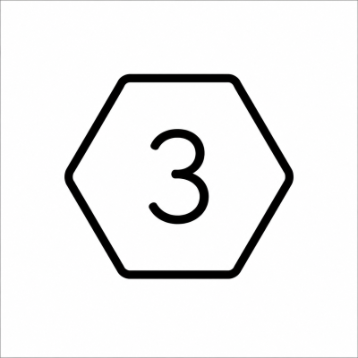
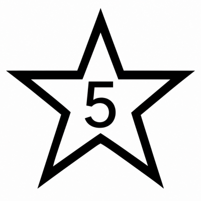
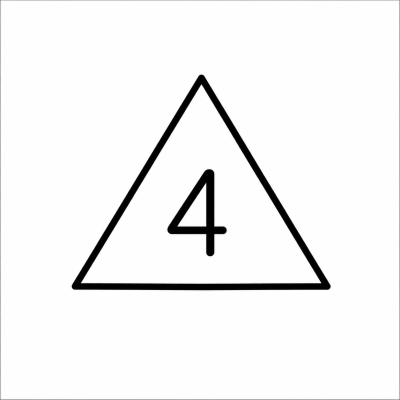
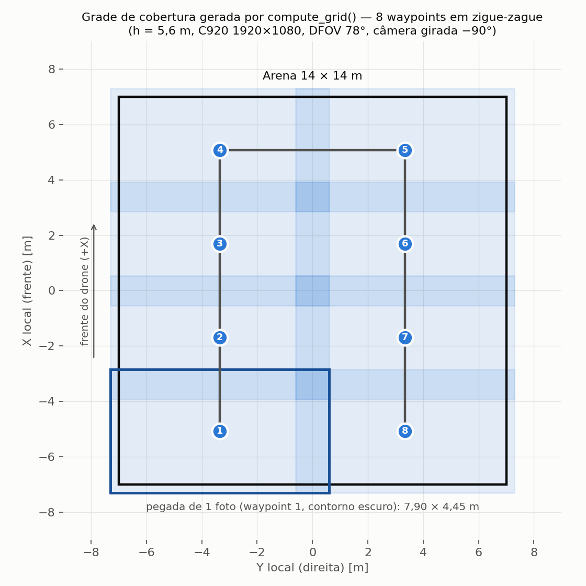
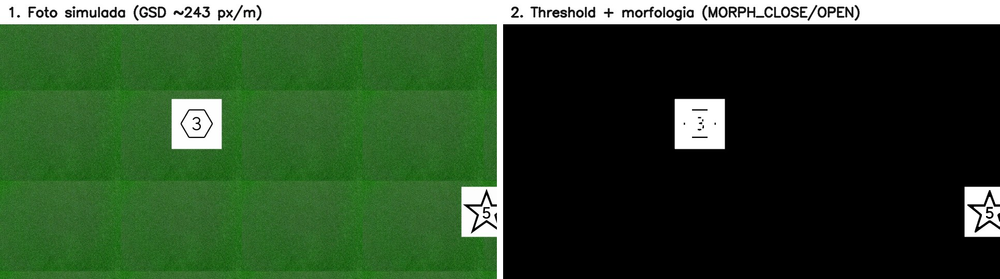
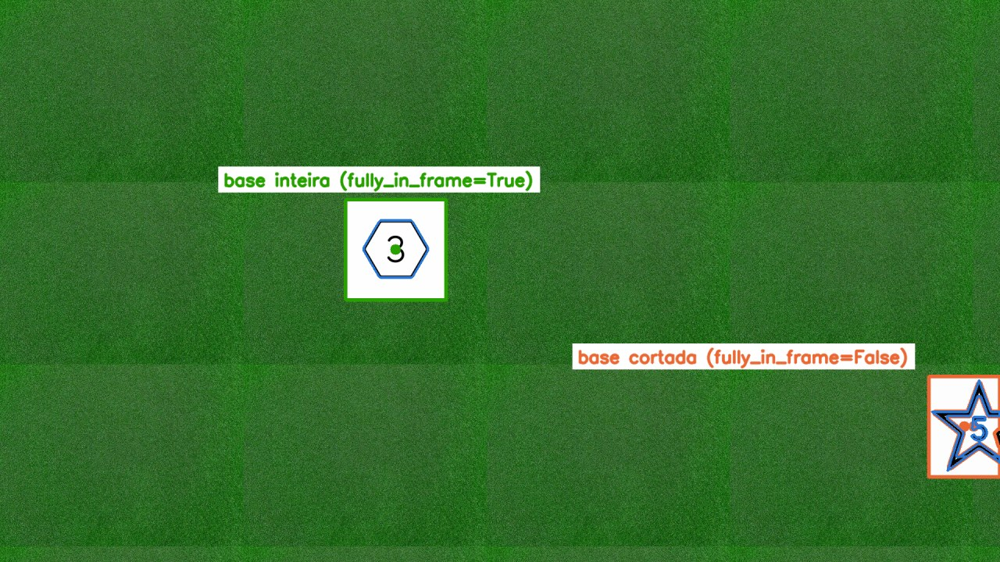

# Visão Computacional para missões de Mapeamento

*Como usamos a câmera para encontrar e georreferenciar as bases na Task 1 da Black Bee Challenge 2026*

**Missão Realizada por Felipe Barros — Black Bee Drones**

**Documento feito por Felipe Barros Salmon**

---

Do alto, a câmera do drone enxerga um retângulo de grama com alguns quadrados brancos espalhados. Para o computador, isso é só uma matriz de pixels. Como transformar essa matriz em uma lista de alvos com a coordenada GPS de cada um?

É isso que a visão computacional faz em uma missão de mapeamento. Neste artigo, explicamos primeiro o que é visão computacional e como ela é usada para mapear com drones. Depois, mostramos como a aplicamos na **Task 1 (Mapeamento)** da Black Bee Challenge 2026, incluindo as contas e o código da missão. Por fim, fechamos com o que aprendemos no desenvolvimento.

## O que é Visão Computacional?

Visão Computacional é um subcampo da área de Inteligência Artificial (IA) que treina os computadores para emular a maneira como os humanos veem, de forma a capacitá-los a processar, analisar e interpretar entradas visuais. Ela usa aprendizado de máquina para ajudar computadores e outros sistemas a obter informações significativas a partir de dados visuais.

A Visão Computacional pode ser retratada como a interação entre três grandes processos, cada um trabalhando em conjunto e informando uns aos outros: reconhecimento, reconstrução e reorganização. O reconhecimento de imagens consiste em identificar ações, objetos, pessoas, lugares e escrita em imagens ou vídeos digitais. A reconstrução deriva as características tridimensionais dessas entidades, enquanto a reorganização infere as relações entre elas (CABALLAR; STRYKER, 2025).

### Como a Visão Computacional é usada?

Sistemas de visão computacional modernos utilizam modelos de **machine learning** e **deep learning** para treinar o sistema a reconhecer aspectos de uma imagem ou vídeo e fazer previsões sobre eles. Os principais tipos de tarefa são (CABALLAR; STRYKER, 2025):

1. **Classificação de imagens**: para inspecionar uma imagem e atribuir-lhe um rótulo de classe com base no conteúdo. Por exemplo, um modelo de classificação de imagens pode ser usado para prever quais imagens contêm um cachorro, um gato ou uma pessoa.
2. **Segmentação de imagens**: para identificar objetos e extraí-los de seu fundo, como isolar um tumor do tecido cerebral circundante em exames de raios-X.
3. **Detecção de objetos**: para analisar imagens ou vídeos e localizar objetos-alvo. Modelos de detecção de objetos geralmente destacam múltiplos objetos simultaneamente e podem ser utilizados em tarefas como a identificação de itens em prateleiras, para um melhor gerenciamento de estoque, ou de anomalias em itens de uma linha de produção.
4. **Rastreamento de objetos**: para rastrear os movimentos de objetos detectados à medida que se deslocam em um ambiente. Por exemplo, o rastreamento de objetos pode ser utilizado na condução autônoma para rastrear pedestres em calçadas ou enquanto atravessam a via.
5. **Extração de características**: para isolar características úteis capturadas em uma imagem ou vídeo e compartilhá-las com um segundo algoritmo de IA, como em sistemas de busca e recuperação baseados em correspondência de imagens. Por exemplo, a extração de características pode ser utilizada para automatizar o monitoramento de tráfego e a detecção de incidentes.
6. **Reconhecimento óptico de caracteres**: para extrair e converter texto de uma imagem em um formato legível por máquina. Essa tecnologia é frequentemente utilizada nos setores bancário e de saúde para processar documentos importantes e registros de pacientes.

### Treinamento de modelos de visão computacional

Antes que um sistema de visão computacional possa entrar em operação, cientistas de dados e desenvolvedores precisam treinar o modelo de deep learning do sistema para o seu caso de uso específico. Isso exige a inserção de grandes volumes de dados específicos da aplicação, que o modelo utilizará para reconhecer aquilo que foi desenvolvido para identificar. Por exemplo, para uma aplicação de visão computacional projetada para reconhecer um cachorro, o modelo deve primeiro aprender a aparência de um cachorro. Ele faz isso sendo treinado com milhares, ou até milhões, de imagens de cães de diferentes raças, tamanhos, cores e características.

Na maioria dos casos, o treinamento ocorre em data centers ou ambientes de nuvem. Para iniciativas de treinamento particularmente complexas, podem ser utilizadas GPUs e aceleradores de IA para agilizar o processo e lidar melhor com o elevado número de parâmetros envolvidos. Após concluir a fase de treinamento, o modelo possui o conhecimento necessário para interpretar e inferir informações a partir de imagens digitais. O modelo também pode passar por ajustes finos (*fine-tuning*) ou ser retreinado ao longo do tempo.

Para acelerar o desenvolvimento e evitar começar do zero, quem deseja criar soluções de visão computacional pode utilizar modelos fundamentais prontos (*off-the-shelf*) como ponto de partida para ajustes finos.

Embora as soluções de visão computacional possam executar cargas de trabalho de inferência na nuvem ou em data centers, muitas organizações estão explorando atualmente aplicações de *edge AI*, nas quais modelos de visão computacional são executados mais próximos da fonte de geração dos dados, utilizando hardware de borda leve e otimizado ou dispositivos embarcados (CABALLAR; STRYKER, 2025). É o caso de um drone, que precisa processar as imagens com o computador que leva a bordo.

## Visão computacional em missões de mapeamento

Mapear com um drone significa responder a duas perguntas ao mesmo tempo: **onde o drone está** e **o que existe ao redor dele, em que coordenadas** (GUPTA; FERNANDO, 2022). Para colocar um objeto no mapa, precisamos saber onde a câmera estava quando o fotografou. Essa dependência mútua é a origem do **SLAM** (*Simultaneous Localization and Mapping*), em que o robô estima a própria posição enquanto constrói o mapa do ambiente (ZHUANG et al., 2024).

### A câmera como sensor

Drones podem carregar LiDAR, sonar ou câmeras térmicas, mas a câmera RGB comum é de longe o sensor mais usado (CAZZATO et al., 2020). Ela é barata, leve, consome pouca energia, captura muitos quadros por segundo e traz informação rica de cor e textura (ZHUANG et al., 2024).

O ponto fraco é que uma câmera **monocular** não mede profundidade. Sozinha, ela não sabe se está a 5 m de um objeto pequeno ou a 50 m de um objeto grande: é a chamada **ambiguidade de escala**. Por isso a câmera quase sempre trabalha junto de outros sensores, como IMU, GPS, barômetro ou telêmetro laser, que dão a ela a escala que falta (GUPTA; FERNANDO, 2022; WANG et al., 2024).

### A altura muda o problema

Cazzato et al. (2020) classificam a visão computacional em drones pela altura de voo, porque o tipo de imagem muda completamente:

| Faixa | Altura | O que muda |
|---|---|---|
| Nível dos olhos | 0–5 m | Visão quase frontal, parecida com a de uma pessoa. |
| Baixa e média altura | 5–120 m | A câmera passa a olhar o chão de cima. É a faixa da maioria das aplicações comerciais. |
| Imageamento aéreo | ≥ 120 m | Objetos minúsculos, grandes áreas, próximo do sensoriamento por satélite. |

Quanto mais alto o drone voa, mais chão cabe em cada foto e menos pixels cada objeto ocupa. Vistos de cima, os objetos também aparecem em orientações arbitrárias e sobre fundos poluídos, o que dificulta a detecção (CAZZATO et al., 2020).

### Duas formas de mapear com imagens

A primeira é o **SLAM visual**. A odometria visual estima o movimento do drone comparando quadros consecutivos, e um *back-end* refina as poses e o mapa por *bundle adjustment*. Um módulo de fechamento de laço corrige o erro acumulado quando o drone volta a um lugar conhecido (ZHUANG et al., 2024). As correspondências entre imagens vêm de features como SIFT e ORB ou, nos métodos diretos, da própria intensidade dos pixels. Muitos desses algoritmos, porém, não rodam diretamente a bordo, por causa da carga útil e do poder de processamento limitados dos drones (KANELLAKIS; NIKOLAKOPOULOS, 2017).

A segunda é a **fotogrametria aérea**. O drone segue um plano de voo, tira fotos com sobreposição e, conhecendo a pose da câmera em cada foto, projeta cada pixel no terreno (GUPTA; FERNANDO, 2022). A peça central dessa projeção é o quanto do chão cada pixel representa, o **GSD** (*Ground Sample Distance*). A uma altura *h*, uma câmera com campo de visão horizontal θ e largura de *W* pixels enxerga uma faixa de chão de:

$$
L = 2 \cdot h \cdot \tan\left(\frac{\theta}{2}\right)
\qquad
\text{GSD} = \frac{L}{W}
$$

Para que o mapa tenha coordenadas reais, ele ainda precisa ser **georreferenciado**, ou seja, convertido para latitude e longitude (GUPTA; FERNANDO, 2022).

### Detectando o que importa

Muitas vezes o que interessa não é o mapa em si, mas **onde estão certos objetos**: pessoas numa busca e salvamento, veículos no trânsito ou, no nosso caso, bases no chão. Isso é **detecção de objetos**: dizer se há instâncias de uma classe na imagem e onde cada uma está (CAZZATO et al., 2020).

Os detectores se dividem em duas famílias. Os **clássicos** usam features feitas à mão, como limiares de cor, contornos e geometria. São leves e não precisam de dados rotulados, mas são sensíveis a mudanças de iluminação. Os de **aprendizado profundo** aprendem as features a partir de exemplos rotulados e lidam melhor com variações de aparência, mas precisam de dataset, treino e mais processamento. Entre eles há os de dois estágios, como o Faster R-CNN, que primeiro propõem regiões candidatas e depois as classificam, e os de um estágio, como o **YOLO**, que prevê caixas e classes numa única passada pela rede e por isso é bem mais rápido (CAZZATO et al., 2020). Em baixas alturas, os pipelines clássicos ainda são comuns, justamente quando falta GPU embarcada ou dados rotulados do ambiente (CAZZATO et al., 2020).

## Aplicando a visão computacional na missão

Na **Task 1** da Black Bee Challenge 2026, o drone precisava sobrevoar uma arena de **14 × 14 m** e encontrar até 5 bases no chão: quadrados brancos de **80 × 80 cm** com uma forma e um número desenhados. Para cada base, o drone devia entregar **uma foto em que ela aparecesse inteira** e sua **coordenada GPS**.

<div align="center">
    
    
    
</div>

*Exemplos de bases usadas na simulação.*

Na classificação de Cazzato et al. (2020), essa é uma tarefa de **baixa altura**: voamos a **5,6 m**, com uma **Logitech C920** em 1920 × 1080 apontada para o chão. Seguimos o caminho da fotogrametria. O drone já tem GPS e um telêmetro laser que mede a altura, então não precisamos estimar a posição dele pelas imagens, como faria um SLAM visual. A arena também é pequena e plana, o que torna válida a hipótese de chão plano usada nas projeções. Com isso, a visão computacional se concentra em **encontrar as bases e projetá-las no chão**.

### Quanto do chão cada foto enxerga

O primeiro passo é calcular o GSD. O datasheet da C920 informa um campo de visão de **78°**, mas esse valor é **diagonal**, não horizontal. Em uma lente sem distorção (modelo *pinhole*), a tangente do meio-ângulo é proporcional à distância em pixels até o centro da imagem, seja na horizontal, na vertical ou na diagonal. Assim, podemos converter:

```text
diagonal = √(1920² + 1080²) ≈ 2203 px
tan(HFOV/2) = tan(78°/2) × 1920 / 2203  →  HFOV ≈ 70,4°
```

Com o HFOV correto, a 5,6 m de altura cada foto cobre **7,90 × 4,45 m** do chão. A imagem é 16:9, então a área vista é um retângulo, não um quadrado, e o FOV vertical (≈ 43,3°) sai da mesma relação usando a altura da imagem. Isso dá um GSD de cerca de **4,1 mm por pixel** (≈ 243 px/m), igual nos dois eixos. Uma base de 80 cm aparece, portanto, com cerca de **194 × 194 pixels**, e esse número é usado pelo detector.

Sabendo o tamanho de cada foto no chão, calculamos o menor número de pontos de captura que cobre a arena inteira sem deixar buracos, com 0,3 m de folga além de cada borda. O resultado são **8 fotos**, organizadas em zigue-zague:

<div align="center">
    
</div>

*Pontos de captura calculados pelo nosso código. Cada retângulo azul é a área vista por uma foto; as faixas mais escuras são as sobreposições. A câmera é montada girada 90° em relação à frente do drone, por isso o lado largo da foto fica na direção lateral.*

A sobreposição é proposital. Ela garante cobertura mesmo com pequenos erros de posição e faz com que uma mesma base possa aparecer em mais de uma foto, o que aproveitamos no fim do processo.

### Escolhendo a foto mais nítida

O drone nunca fica perfeitamente parado, e algumas fotos saem tremidas. Por isso, em cada ponto esperamos 2 segundos para o drone estabilizar, tiramos 5 fotos e ficamos com a mais nítida. A medida de nitidez é a **variância do Laplaciano**. O Laplaciano é a segunda derivada da imagem e realça as bordas: uma imagem nítida tem bordas fortes e variância alta, e uma imagem borrada tem variância baixa. Essa medida depende do conteúdo da cena, mas, como as 5 fotos são do mesmo lugar, a comparação entre elas é justa.

Junto de cada foto guardamos a posição do ponto de captura, o quanto o drone girou desde a decolagem e a **altura medida pelo telêmetro laser**. É o telêmetro que resolve a ambiguidade de escala da câmera: como o GSD é proporcional à altura, um erro de 10 cm a 5,6 m (cerca de 2%) erra em cerca de 2% a distância calculada entre cada base e o ponto logo abaixo do drone. Uma base na borda da foto, a uns 4 m desse ponto, ficaria cerca de 7 cm fora do lugar.

### Corrigindo a imagem

Antes da detecção, cada foto passa por duas correções:

- **Distorção da lente**: com a matriz da câmera e os coeficientes de distorção obtidos na calibração com tabuleiro de xadrez, removemos as distorções radial e tangencial. Sem isso, uma base perto da borda da foto teria a posição calculada errada, porque a distorção desloca os pixels mais longe do centro.
- **Balanço de branco *gray world***: assumimos que a cor média da cena deveria ser um cinza neutro e reescalamos cada canal de cor. Isso deixa o branco das bases mais consistente sob luz amarelada. A hipótese tem um limite: numa cena dominada pela grama, a média tende ao verde, e a correção puxa a imagem um pouco para o magenta. Para o detector clássico isso pesa pouco, porque ele trabalha com o brilho e o branco da base continua sendo a região mais clara da foto.

### Encontrando as bases

Implementamos dois detectores com a mesma interface, e a escolha entre eles é feita no arquivo de configuração: um clássico, com OpenCV, e um com **YOLO**, que é o que está configurado para a missão.

O detector clássico parte do fato de que as bases têm uma assinatura visual forte: são **quadrados brancos de tamanho conhecido** sobre um piso mais escuro. Como já sabemos o GSD, sabemos também **quantos pixels uma base deve ocupar**. O detector usa essas duas informações:

1. **Limiarização**: separa os pixels com brilho acima de 200 (numa escala de 0 a 255), candidatos a base, do resto da imagem.
2. **Morfologia**: o fechamento une pequenas falhas da região branca, e a abertura remove pontos isolados de ruído.
3. **Contornos e geometria**: pegamos só o contorno externo de cada região, então o desenho preto dentro da base não atrapalha. Cada região só é aceita se tiver **área compatível** com 80 × 80 cm (com tolerância de 35%) e for **aproximadamente quadrada** (razão entre os lados de no máximo 1,3).
4. **Enquadramento**: verificamos se o contorno inteiro está dentro da imagem, porque só vale a foto em que a base aparece completa.

<div align="center">
    
</div>

<div align="center">
    
</div>

*Detector clássico rodando em uma cena sintética, montada com a textura de grama da simulação e bases em escala real. A base da esquerda é aceita como inteira. A da direita, cortada pela borda, não serve como foto de prova; ela só aparece no modo de recuperação de bordas, marcada como incompleta. Em azul, o contorno do desenho interno.*

O detector com **YOLO** foi treinado com imagens das mesmas bases. O modelo tem uma classe para cada forma (hexágono, estrela, triângulo) e outra para cada número (3, 4, 5), mas nenhuma classe "base". Por isso, uma base aparece como duas caixas, uma dentro da outra, e as juntamos casando cada forma com o número cujo centro cai dentro dela. Uma vantagem é que a forma e o número já saem classificados. Isso não é exigido para pontuar, mas facilita conferir que cada foto enviada mostra uma base diferente. O detector clássico fica como alternativa que não depende de treino nem de bibliotecas de IA.

### Do pixel à coordenada GPS

Detectar a base nos dá um **pixel**, mas precisamos de uma **coordenada GPS**. A conversão tem duas etapas.

**Do pixel ao chão.** Pelo modelo de câmera *pinhole*, cada pixel corresponde a um raio que sai da lente. Giramos esse raio pela montagem da câmera e pela orientação do drone e calculamos onde ele toca o chão. Com o drone nivelado, isso equivale à conta simples, feita nos eixos da câmera:

```text
deslocamento no chão = (pixel − centro da imagem) × GSD
```

Depois, esse deslocamento é girado para os eixos da arena e somado à posição do drone. A rotação inclui os 90° da montagem da câmera: o topo da imagem corresponde à frente do drone.

**Do chão ao GPS.** A organização informa a coordenada GPS dos 4 cantos da arena. Com eles, ajustamos por **mínimos quadrados** uma transformação afim entre metros na arena e latitude/longitude, que combina rotação, escala e translação. São 4 pontos para 3 incógnitas por coordenada, então o ajuste também dilui pequenos erros na medição dos cantos. Numa área de 14 m, a curvatura da Terra é desprezível e essa relação é praticamente linear.

### Juntando várias fotos da mesma base

Como as fotos se sobrepõem, uma base pode aparecer em 2 ou 3 delas. Agrupamos as detecções que caem a menos de 0,5 m umas das outras no chão e transformamos cada grupo em uma única base:

- **Mais fotos, mais confiança**: um grupo confirmado por várias fotos tem menos chance de ser um falso positivo do que uma detecção isolada.
- **Melhor foto de prova**: escolhemos a foto em que a base aparece inteira e mais nítida.
- **Média ponderada da posição**: detecções perto do centro da imagem sofrem menos com distorção residual e com a inclinação do drone, então pesam mais na posição final. O peso vale 1,0 no centro e cai linearmente com a distância a ele, até um mínimo de 0,1 perto dos cantos.

## Implementação no código

### O Nectar SDK

O **[Nectar](https://github.com/Black-Bee-Drones/nectar-sdk)** é o SDK da Black Bee Drones que abstrai o controle do drone e o acesso à câmera. Nesta missão usamos o `MavrosDrone`, para mover o drone até cada ponto com `move_to()` e ler a altura do telêmetro, e o `ImageHandler`, para tirar as fotos com `take_photo()`. Quando não indicamos outro arquivo, a calibração da câmera também é carregada do Nectar.

A missão é organizada como uma máquina de estados com a **YASMIN**. Toda a parte de visão e geometria, porém, fica em funções puras, que dependem só de `numpy`, `OpenCV` e `math`. Assim conseguimos testar cada etapa sem drone e sem câmera. As figuras deste artigo foram geradas chamando essas mesmas funções.

### Calculando o tamanho da foto no chão

A conversão de FOV diagonal para horizontal e o cálculo da área vista por uma foto ficam em `utils/coverage.py`:

```python
def hfov_from_dfov(dfov_deg, resolution):
    width_px, height_px = resolution
    diagonal_px = math.hypot(width_px, height_px)
    half_dfov = math.radians(dfov_deg) / 2

    half_hfov = math.atan(math.tan(half_dfov) * (width_px / diagonal_px))
    return 2 * math.degrees(half_hfov)


def camera_footprint(altitude_m, hfov_deg, resolution):
    width_px, height_px = resolution
    half_hfov = math.radians(hfov_deg) / 2

    footprint_x = 2 * altitude_m * math.tan(half_hfov)

    # mesma lente nos dois eixos: o FOV vertical sai da proporção da imagem
    half_vfov = math.atan(math.tan(half_hfov) * (height_px / width_px))
    footprint_y = 2 * altitude_m * math.tan(half_vfov)

    return footprint_x, footprint_y
```

### Capturando a foto mais nítida

Em cada ponto, o estado `CaptureWaypoint` espera o drone estabilizar, tira várias fotos e escolhe a de maior nitidez:

```python
def sharpness_score(img):
    gray = cv2.cvtColor(img, cv2.COLOR_BGR2GRAY) if img.ndim == 3 else img
    return float(cv2.Laplacian(gray, cv2.CV_64F).var())
```

```python
drone.delay(self.config.mission.stabilize_seconds)

photos = []
for _ in range(self.config.mission.photos_per_waypoint):
    photo = self.image_handler.take_photo(timeout_sec=2.0)
    if photo is not None:
        photos.append(photo)

best_photo, score = pick_sharpest(photos)
```

Logo depois, lemos a altura real pelo telêmetro em vez de usar a altitude de voo planejada:

```python
current_altitude = drone.get_altitude(AltitudeSource.LIDAR)
```

### Corrigindo a imagem

As duas correções ficam em `utils/image_pipeline.py`:

```python
def undistort(img, camera_matrix, dist_coeffs):
    h, w = img.shape[:2]
    new_camera_matrix, _ = cv2.getOptimalNewCameraMatrix(
        camera_matrix, dist_coeffs, (w, h), alpha=0
    )
    return cv2.undistort(img, camera_matrix, dist_coeffs, None, new_camera_matrix)


def white_balance_gray_world(img):
    img_float = img.astype(np.float32)
    channel_means = img_float.mean(axis=(0, 1))
    gray_mean = channel_means.mean()

    scales = gray_mean / np.clip(channel_means, 1e-6, None)
    balanced = img_float * scales
    return np.clip(balanced, 0, 255).astype(np.uint8)
```

### Detectando as bases

O detector clássico está na função `find_base_squares()`, que recebe a foto e o lado esperado da base em pixels:

```python
gray = cv2.cvtColor(img, cv2.COLOR_BGR2GRAY)
_, mask = cv2.threshold(gray, white_threshold, 255, cv2.THRESH_BINARY)

kernel = np.ones((5, 5), np.uint8)
mask = cv2.morphologyEx(mask, cv2.MORPH_CLOSE, kernel)
mask = cv2.morphologyEx(mask, cv2.MORPH_OPEN, kernel)

contours, _ = cv2.findContours(mask, cv2.RETR_EXTERNAL, cv2.CHAIN_APPROX_SIMPLE)
```

Para cada contorno, filtramos pela área esperada e pela forma quadrada, e verificamos se ele toca a borda da imagem:

```python
expected_area = expected_side_px**2
min_area = expected_area * (1 - area_tolerance)
max_area = expected_area * (1 + area_tolerance)

for contour in contours:
    area = cv2.contourArea(contour)
    x, y, bw, bh = cv2.boundingRect(contour)
    fully_in_frame = x > 0 and y > 0 and (x + bw) < w and (y + bh) < h

    (cx, cy), (rw, rh), _ = cv2.minAreaRect(contour)
    if not (min_area <= area <= max_area):
        continue
    aspect = rw / rh if rw > rh else rh / rw
    if aspect > 1.3:  # não é quadrado o suficiente
        continue
```

No caminho com IA, o modelo é carregado com a biblioteca Ultralytics e devolve as caixas detectadas com confiança acima de 0,5:

```python
result = model.predict(img, conf=confidence, verbose=False)[0]
names = result.names
boxes = [
    (names[int(box.cls[0])], tuple(box.xyxy[0].tolist()))
    for box in result.boxes
]
```

Em seguida, `_pair_shapes_and_numbers()` junta cada forma ao número mais próximo cujo centro está dentro dela:

```python
for shape_name, (x0, y0, x1, y1) in shapes:
    scx, scy = (x0 + x1) / 2, (y0 + y1) / 2
    side = max(x1 - x0, y1 - y0)

    nearest_number, nearest_dist = None, None
    for num_name, (nx0, ny0, nx1, ny1) in numbers:
        ncx, ncy = (nx0 + nx1) / 2, (ny0 + ny1) / 2
        dist = math.hypot(ncx - scx, ncy - scy)
        if dist <= side / 2 and (nearest_dist is None or dist < nearest_dist):
            nearest_number, nearest_dist = num_name, dist

    paired.append((shape_name, (x0, y0, x1, y1), nearest_number))
```

### Do pixel ao GPS

A função `pixel_to_local()` monta o raio do pixel, gira pela montagem da câmera e pela orientação do drone, e intersecta com o chão:

```python
along_x_px = pixel_col - width_px / 2
along_y_px = height_px / 2 - pixel_row

focal_px = camera_altitude_m / gsd_m_per_px
x, y, z = along_x_px / focal_px, along_y_px / focal_px, 1.0

x, y = _rotate_2d(x, y, camera_yaw_offset_deg)    # montagem da câmera
y, z = _rotate_2d(y, z, pose.roll_deg)            # inclinação lateral
z, x = _rotate_2d(z, x, pose.pitch_deg)           # inclinação frontal
x, y = _rotate_2d(x, y, pose.heading_offset_deg)  # guinada do drone

t = camera_altitude_m / z                         # onde o raio toca o chão
# camera_x, camera_y: posição da lente na arena (drone + offset de montagem)
return camera_x + t * x, camera_y + t * y
```

E a classe `LocalToGpsTransform` ajusta a transformação afim a partir dos 4 cantos da arena:

```python
design_matrix = np.array([[x, y, 1.0] for x, y in local_corners])
self._lat_coeffs, *_ = np.linalg.lstsq(design_matrix, lats, rcond=None)
self._lon_coeffs, *_ = np.linalg.lstsq(design_matrix, lons, rcond=None)
```

### Juntando as detecções

Por fim, `deduplicate()` ordena os grupos pelo número de fotos que os confirmam, escolhe a melhor foto de prova e calcula a posição média ponderada:

```python
clusters.sort(key=len, reverse=True)

for cluster in clusters[:max_bases]:
    # primeiro as fotos com a base inteira, depois a mais nítida
    best = max(cluster, key=lambda c: (c.detection.fully_in_frame, c.sharpness))

    # detecções perto do centro da imagem pesam mais
    total_weight = sum(c.weight for c in cluster)
    local_x = sum(c.local_x * c.weight for c in cluster) / total_weight
    local_y = sum(c.local_y * c.weight for c in cluster) / total_weight
```

## Conclusão

A Task 1 mostrou que, quando a geometria do problema é conhecida, um pipeline de visão computacional relativamente simples resolve a maior parte da tarefa. A geometria da câmera definiu quantas fotos tirar e quantos pixels uma base ocupa. O processamento de imagem clássico escolheu e corrigiu as fotos. Os detectores, com YOLO ou com limiar e contornos, encontraram as bases, e o modelo *pinhole* com uma transformação afim levou cada pixel até uma coordenada GPS.

O desenvolvimento deixou algumas lições:

- **Leia o datasheet com atenção.** Tratar os 78° diagonais da C920 como horizontais fazia o drone tirar 6 fotos em vez de 8 e deixava pedaços da arena sem cobertura, sem nenhuma mensagem de erro.
- **Visualize o que o código calcula.** Um erro de eixos trocados na projeção pixel → chão só apareceu quando montamos um mosaico com fotos sintéticas e ele cobria 73% da arena, e não os 100% esperados.
- **A visão depende dos outros sensores.** Sem a altura do telêmetro, a câmera não sabe a escala, e todo o resto do pipeline herda esse erro.
- **Simulação não substitui o campo.** Como lembram Wang et al. (2024), a avaliação no cenário real mostra o desempenho de verdade. O limiar de branco do detector clássico, por exemplo, precisa ser calibrado com a iluminação do local, e o YOLO precisa de imagens de treino próximas das condições reais.

## Referências

CABALLAR, R.; STRYKER, C. **What is computer vision?** IBM Think, 2025. Disponível em: https://www.ibm.com/think/topics/computer-vision.

CAZZATO, D.; CIMARELLI, C.; SANCHEZ-LOPEZ, J. L.; VOOS, H.; LEO, M. A Survey of Computer Vision Methods for 2D Object Detection from Unmanned Aerial Vehicles. **Journal of Imaging**, v. 6, n. 8, p. 78, 2020. DOI: 10.3390/jimaging6080078.

GUPTA, A.; FERNANDO, X. Simultaneous Localization and Mapping (SLAM) and Data Fusion in Unmanned Aerial Vehicles: Recent Advances and Challenges. **Drones**, v. 6, n. 4, p. 85, 2022. DOI: 10.3390/drones6040085.

KANELLAKIS, C.; NIKOLAKOPOULOS, G. Survey on Computer Vision for UAVs: Current Developments and Trends. **Journal of Intelligent & Robotic Systems**, v. 87, p. 141–168, 2017. DOI: 10.1007/s10846-017-0483-z.

WANG, K.; KOOISTRA, L.; PAN, R.; WANG, W.; VALENTE, J. UAV-based simultaneous localization and mapping in outdoor environments: A systematic scoping review. **Journal of Field Robotics**, v. 41, n. 5, p. 1617–1642, 2024. DOI: 10.1002/rob.22325.

ZHUANG, L.; ZHONG, X.; XU, L.; TIAN, C.; YU, W. Visual SLAM for Unmanned Aerial Vehicles: Localization and Perception. **Sensors**, v. 24, n. 10, p. 2980, 2024. DOI: 10.3390/s24102980.
