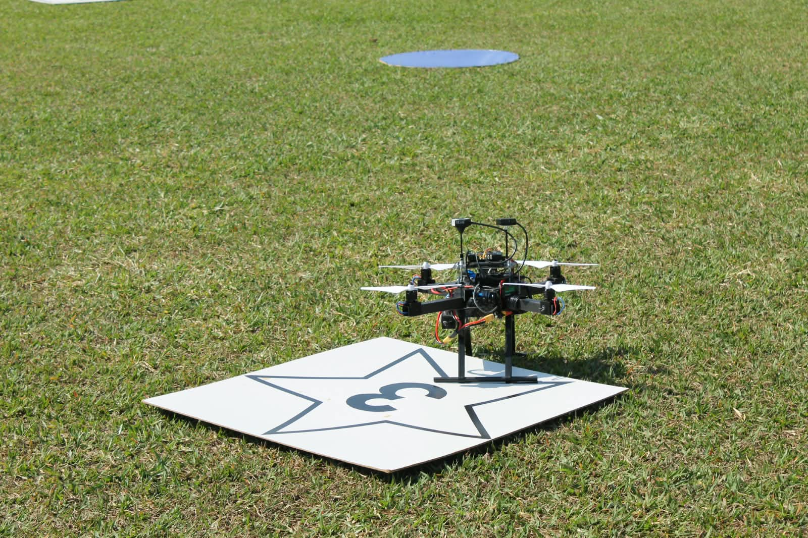

# Controle PID no Pouso de Precisão

*Como o PID guiou nosso drone até a base na Task 2 do Black Bee Challenge 2026*

**Missão Realizada por João Gourgel, Pedro Bevilaqua e Pedro Duarte — Black Bee Drones**

**Documento Feito por Pedro Horta Bevilaqua**

---

O controle PID está presente em praticamente toda a robótica e é peça-chave no desenvolvimento dos drones autônomos da Black Bee. Sem ele, o drone não conseguiria nem sair de um ponto e chegar a outro de forma estável.

Neste artigo, explicamos primeiro o conceito por trás do PID, com um exemplo simples. Depois, mostramos como o aplicamos na **Task 2 (Precision Landing)** do Black Bee Challenge 2026, incluindo o código que rodou no drone, e fechamos com os resultados e o que aprendemos.

## O que é o controle PID?

PID vem de **P**roporcional, **I**ntegral e **D**erivativo. Ele é um controlador de malha fechada: a todo instante compara onde o sistema **está** com onde ele **deveria estar** (o *erro*) e calcula um comando que reduz essa diferença.

Imagine que o drone está na posição XY (0, 0) e precisa ir até a posição XY (10, 0). O erro em X é de 10 m. Para chegar lá, o drone precisa de uma velocidade em X: rápida o bastante para não demorar, mas sem passar do ponto nem frear tarde demais. É aí que o PID entra: a partir do erro e de três constantes, **Kp**, **Ki** e **Kd**, ele calcula a velocidade que queremos que o drone atinja.

Cada constante pesa um componente do controlador, e a soma dos três é a saída final. Vamos a eles.

### O Proporcional (P)

O P é o responsável pela maior parte do movimento. Ele gera uma saída diretamente proporcional ao erro atual:

$$
P = K_p\cdot e(t)
$$

Com Kp = 0,5 no nosso exemplo, um erro de 10 m resulta em uma velocidade de 5 m/s. Conforme o drone se aproxima, o erro diminui e a velocidade cai na mesma proporção: com 5 m de erro, a velocidade é 2,5 m/s; com 1 m, é 0,5 m/s. Isso cria uma frenagem suave e natural, rápida quando o drone está longe e cada vez mais lenta perto do destino.

### O Integral (I)

O P sozinho costuma ser uma ótima solução, mas tem um ponto fraco. Perto do destino, o erro é tão pequeno que a saída do P também fica quase nula. Qualquer perturbação, como vento, atrito ou a zona morta dos atuadores, pode ser forte o bastante para impedir o drone de fechar o último trecho. Ele fica parado a alguns centímetros do alvo, e esse é o chamado **erro em regime permanente**.

<div align="center">
    
</div>

O Integral resolve isso acumulando o erro ao longo do tempo. Matematicamente, ele é a área sob a curva do erro:

$$
I = K_i \int_0^t e(\tau),d\tau
$$

Enquanto existir um erro, mesmo pequeno, essa área continua crescendo e soma um "empurrãozinho" na saída, até o drone finalmente alcançar o destino e o erro zerar.

### O Derivativo (D)

O Integral traz um efeito colateral: como ele acumula erro, pode fazer o drone **passar do ponto** (o *overshoot*) e depois precisar voltar, o que pode virar um vai e volta em torno do alvo.

<div align="center">
    
</div>

O Derivativo age como um freio. Ele é calculado pela **taxa de variação do erro**:

$$
D = K_d \frac{de(t)}{dt}
$$

Quando o drone se aproxima rapidamente do destino, o erro diminui rápido e a derivada é negativa. Esse valor é somado à saída e desacelera o drone antes de ele chegar, reduzindo overshoot e oscilações. Por outro lado, o D é sensível a ruído nas medições, então deve ser usado com cautela.

### A saída completa

A saída do PID é a soma dos três componentes. Qualquer um deles pode ser desligado simplesmente zerando sua constante:

$$
u(t) =
K_p e(t)
+
K_i \int_0^t e(\tau),d\tau
+
K_d\frac{de(t)}{dt}
$$

<div align="center">
    
</div>

<div align="center">
    
</div>

A partir dessa saída, definimos a velocidade que o drone deve executar.

### Limites do PID: saturação e anti-windup

Até aqui tratamos o controlador como ideal, mas drones reais têm limites físicos. Os motores, por exemplo, têm uma rotação máxima.

Considere este experimento mental: você segura o drone por um dos trens de pouso no momento da decolagem, com o PID já calibrado. O erro em Z é positivo e, como você o impede de subir, continua constante. O I segue somando o mesmo erro a cada instante, aumentando cada vez mais o comando, até os motores chegarem à rotação máxima e ficarem ali.

Alguns segundos depois, você solta o drone. Ele sobe com força total e o erro despenca. Mas o I acumulou tanto valor que continua empurrando para cima mesmo depois de o drone atingir a altura desejada. O drone só começa a desacelerar depois de ultrapassar a altura, e aí já é tarde. Esse fenômeno se chama ***integral windup***.

A solução é o ***anti-windup***: impor limites ao termo integral, de modo que ele não continue crescendo quando o sistema já está saturado. Na prática, usamos dois tipos de limite, e os dois aparecem na nossa implementação:

- **Limite de saída (*output limits*):** restringe o comando final a uma faixa segura (no nosso caso, velocidades).
- **Limite do integral (*integral limits*):** restringe o quanto o termo I pode acumular.

## Aplicando o PID na missão

Na Task 2 do Black Bee Challenge 2026, o drone precisava realizar um **pouso de precisão** sobre uma base indicada por um ArUco na arena. A base é detectada pela câmera, e o PID usa a posição dela na imagem para alinhar o drone antes da descida.

### Os controladores

Ao iniciar o estado de pouso de precisão, criamos controladores PID para os eixos X, Y e Z, com os seguintes valores:

```
Kp = 0.250
Ki = 0.0012
Kd = 0.0
Limites de saída    = (-0.44, 0.44)
Limites do integral = (-0.1, 0.1)
```

Como Kd é zero, na prática o controlador de X e Y é um **PI**. Os limites de saída mantêm as velocidades comandadas entre −0,44 e 0,44 m/s, e os limites do integral implementam o anti-windup descrito acima.

### Do pixel ao metro: calculando o erro

A detecção da base é feita pelo modelo **YOLO26n**. O centro da *bounding box* é salvo em *target_x* e *target_y*, que representam onde a base está na imagem. Como queremos a base no centro da imagem, o erro em pixels é a distância entre os dois:

```
erro_x_pixel = target_x − largura_da_imagem / 2
erro_y_pixel = target_y − altura_da_imagem / 2
```

Mas o PID precisa de um erro em **metros**, não em pixels. Para converter, calculamos quantos pixels cabem em um metro no chão, o que depende da altitude do drone (H), do campo de visão da câmera (θ) e da resolução da imagem (W):

```
PPM(H, θ, W) = W / ( 2 · H · tan(θ / 2) )
```

<div align="center">
    
</div>

A ideia é geométrica: a uma altitude H, a câmera enxerga uma faixa de chão com largura de 2·H·tan(θ/2) metros. Dividindo o número de pixels pela largura dessa faixa, obtemos pixels por metro. O cálculo é feito separadamente para X (usando o FOV horizontal e a largura da imagem) e para Y (usando o FOV vertical e a altura da imagem). O erro final em metros fica:

```
erro_x = erro_x_pixel / PPM(H, HFOV, largura)
erro_y = erro_y_pixel / PPM(H, VFOV, altura)
```

### A saída

Com os erros em metros, os PIDs de X e Y geram *output_x* e *output_y*, que já são as **velocidades** (em m/s) que o drone executa.

No eixo Z não usamos o PID: aplicamos uma velocidade de descida constante de **−0,5 m/s**, mas **somente** se o erro em pixels de X e Y estiver abaixo de uma tolerância. Em outras palavras, o drone primeiro se alinha e só então desce. Se o alinhamento se perder, ele para de descer e corrige a posição.

## Implementação no código

### O Nectar-SDK

O **Nectar** é um SDK criado pela equipe Black Bee Drones para facilitar a execução das missões. Ele organiza em métodos e funções simples toda a abstração que antes precisávamos escrever em Python, e funciona tanto no drone real quanto na simulação.

Um exemplo é o *ImageHandler*, que abstrai a câmera. Basta criar um objeto da classe informando a fonte de imagem, a configuração da câmera e um *callback* que será chamado a cada frame capturado:

```python
camera = ImageHandler(
    image_source=CAMERA_SOURCE,
    config=cam_config,
    image_processing_callback=self.camera_callback,
)
```

Para o controle, usamos principalmente duas classes do módulo *nectar.control*: o *PIDController* e o *MavrosDrone*, que abstrai o controle do drone:

```python
from nectar.control import MavrosDrone, PIDController
```

O *MavrosDrone* oferece, entre outros, dois métodos de movimentação:

- **`drone.move_velocity`**: recebe as velocidades de cada eixo (e de yaw). É o que usamos para aplicar a saída do PID diretamente.
- **`drone.move_to`**: leva o drone a um ponto específico, relativo à posição atual ou à decolagem. Ele já tem um PID embutido, o que facilita muito a navegação.

```python
def move_velocity(
    self,
    vx: float = 0.0,
    vy: float = 0.0,
    vz: float = 0.0,
    vyaw: float = 0.0,
    duration: Optional[float] = None,
    reference: MoveReference = MoveReference.BODY,
) -> None
```
```python
def move_to(
    self,
    x: Optional[float] = None,
    y: Optional[float] = None,
    z: Optional[float] = None,
    yaw: Optional[float] = None,
    reference: MoveReference = MoveReference.BODY,
    timeout: Optional[float] = 60.0,
    precision: float = 0.2,
    method: NavigationMethod = NavigationMethod.PID,
    altitude_source: AltitudeSource = AltitudeSource.AUTO,
) -> bool
```

Nosso código é organizado como uma máquina de estados com a biblioteca **YASMIN**, e a missão de pouso é um dos estados. A *blackboard* da YASMIN funciona como uma memória compartilhada entre os estados; é nela que guardamos, por exemplo, a forma geométrica e o número da base correta.

### Instanciando os PIDs

No *\_\_init\_\_* do estado de pouso de precisão, criamos um *PIDController* do Nectar para cada eixo, passando as constantes e os limites. Abaixo, o de X (o de Y é idêntico, e o de Z segue a mesma estrutura com suas próprias constantes):

```python
self.pid_x = PIDController(
    kp=CONTROLER_P_XY,
    ki=CONTROLER_I_XY,
    kd=CONTROLER_D_XY,
    output_limits=CONTROLER_OUTPUT_LIMITS_XY,
    integral_limits=CONTROLER_INTEGRAL_LIMITS_XY,
)
```

### Calculando o erro

Primeiro, verificamos se a base detectada é a correta. O modelo detecta tanto a forma geométrica quanto o número da base, e a base é válida quando o centro do número está dentro da caixa da forma esperada (ambos salvos na blackboard):

```python
for shape in result.filter_by_class([blackboard["aruco_shape"]]):
    for number in result.filter_by_class([blackboard["aruco_id"]]):
        if (
            abs(shape.center[0] - number.center[0]) <= shape.width / 2
            and abs(shape.center[1] - number.center[1]) <= shape.height / 2
        ):
            ...
```

Em seguida, obtemos a altura e a largura da imagem a partir do objeto *result* e salvamos o centro da base em *target_x* e *target_y*:

```python
h, w = result.image.shape[:2]
target_x = shape.center[1]
target_y = shape.center[0]
```

Calculamos então o erro em pixels:

```python
erro_x_pixel = target_x - w / 2
erro_y_pixel = target_y - h / 2
```

Depois, usamos a função de pixels por metro, que fica dentro do estado:

```python
def PIXEL_POR_METRO(self, altitude_m: float, fov_deg: float, width: float):
    half_fov_rad = math.radians(fov_deg / 2.0)
    return width / (2.0 * altitude_m * math.tan(half_fov_rad))
```

E, por fim, calculamos os erros em metros:

```python
erro_x = erro_x_pixel / self.PIXEL_POR_METRO(drone.get_altitude(), 60, IMAGE_WIDTH)   # HFOV
erro_y = erro_y_pixel / self.PIXEL_POR_METRO(drone.get_altitude(), 47, IMAGE_HEIGHT)  # VFOV
erro_z = drone.get_altitude() - FINAL_LANDING_HEIGHT
```

### Saídas e controle da descida

As saídas de X e Y vêm do método *update()* do PIDController. Para o eixo Z, a descida só é permitida quando o erro em pixels está dentro da tolerância e o drone ainda não chegou à altura final. Acima de 2 m usamos uma tolerância configurável (*PRECISE_DOWN_TOLERANCE_PX*); abaixo disso, uma tolerância fixa de 30 px:

```python
output_x = self.pid_x.update(erro_x)
output_y = self.pid_y.update(erro_y)

if drone.get_altitude() > 2.0:
    aligned = (
        abs(erro_x_pixel) <= PRECISE_DOWN_TOLERANCE_PX
        and abs(erro_y_pixel) <= PRECISE_DOWN_TOLERANCE_PX
    )
else:
    aligned = abs(erro_x_pixel) <= 30 and abs(erro_y_pixel) <= 30

output_z = -0.5 if (aligned and erro_z >= 0) else 0.0
```

Por fim, enviamos as saídas ao drone com o *move_velocity*:

```python
drone.move_velocity(
    vx=output_x,
    vy=output_y,
    vz=output_z,
    vyaw=0.0,
)
```

### Tratamento de perda de detecção

Em alguns casos, o drone pode perder a detecção da base antes de pousar. Tratamos duas situações:

1. **O drone está tão perto que o modelo não enxerga mais a base.** É o momento de pousar: o drone para, espera 1 segundo e chama *drone.land()*.
2. **O drone está alto e apenas perdeu a detecção.** Ele continua se movendo com as últimas velocidades calculadas, na direção da última detecção, até reencontrar a base.

```python
if not TARGET_FOUND:
    alt = drone.get_altitude()

    if (alt <= FINAL_LANDING_HEIGHT) and (
        abs(erro_x) <= FINAL_LANDING_TOLERANCE
        and abs(erro_y) <= FINAL_LANDING_TOLERANCE
    ):
        yasmin.YASMIN_LOG_INFO("TAKING LAST LAND")
        drone.move_velocity(vx=0, vy=0, vz=0)
        drone.delay(1)
        drone.land()
        return SUCCEED

    elif alt < MAX_ALTITUDE:
        yasmin.YASMIN_LOG_INFO("TARGET LOST... DRIFTING TILL FIND")
        drone.move_velocity(vx=output_x, vy=output_y, vz=output_z)
```

## Resultados no dia da missão

Nas duas tentativas válidas, o drone encontrou facilmente a base correta.

- **Primeira tentativa:** o drone perdeu a detecção e a tentativa acabou sendo abortada.
- **Segunda tentativa (a melhor):** o PID funcionou praticamente perfeito, e o drone só descia quando o erro em pixels estava dentro da tolerância, como projetado. Porém, havíamos adicionado um delay para não sobrecarregar a Raspberry Pi, e isso fez o drone dar uma pequena pausa antes de pousar. Provavelmente, nesse intervalo o vento atrapalhou a centralização e o drone pousou um pouco fora do centro da base.

<div align="center">
    
</div>

## Conclusão

A Task 2 mostrou que um controlador simples, bem calibrado e bem limitado, é suficiente para uma tarefa de precisão. Com apenas P e I (Kd = 0), um erro convertido corretamente de pixels para metros e a regra de descer somente quando alinhado, o drone conseguiu seguir a base de forma estável. Os limites de saída e de integral cumpriram o papel de evitar o windup e manter as velocidades em uma faixa segura.

O dia da missão também deixou lições importantes:

- **O controlador é tão bom quanto o resto do sistema.** O PID funcionou bem, mas a primeira tentativa foi comprometida pela perda de detecção, e a segunda, por um detalhe de latência. A percepção e o tempo de resposta pesam tanto quanto o ajuste das constantes.
- **Otimizações têm custo.** O delay colocado para poupar a Raspberry Pi parece simples, mas, em um momento crítico como o pouso, qualquer pausa deixa o drone à mercê do vento.
- **Conhecer os limites é parte do projeto.** Entender saturação e anti-windup foi tão importante quanto entender P, I e D.

Para as próximas missões, pretendemos reduzir a latência no fim do pouso, avaliar o uso de um termo derivativo para suavizar a aproximação final e tornar a recuperação após perda de detecção mais robusta.

Se você curtiu este estudo, acompanhe o trabalho da **Black Bee Drones** e continue conosco nos próximos artigos.